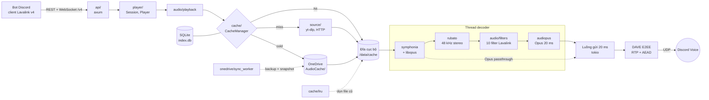
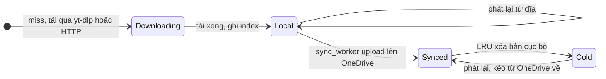

<div align="center">

# rust-link

**Audio node viết bằng Rust thay thế trực tiếp Lavalink v4 cho bot Discord, giữ nhạc đã phát trong cache cục bộ có backup OneDrive để lần sau không phải tải lại.**

[](https://github.com/otkhovps-sys/rust-link/actions/workflows/ci.yml)
[](https://github.com/otkhovps-sys/rust-link/actions/workflows/release.yml)
[](https://github.com/otkhovps-sys/rust-link/releases/latest)
[](LICENSE)
[](https://www.rust-lang.org)
[](https://lavalink.dev/api/)
[](#-cài-đặt)

[Tính năng](#-tính-năng-chính) ·
[Kiến trúc](#-kiến-trúc) ·
[Cài đặt](#-cài-đặt) ·
[Chạy nhanh](#-chạy-nhanh-và-cấu-hình) ·
[Cấu trúc mã](#-cấu-trúc-thư-mục) ·
[Đóng góp](#-roadmap-đóng-góp-và-giấy-phép) ·
[Hướng dẫn đầy đủ](docs/HUONG_DAN.md)

</div>

---

## ✨ Tính năng chính

- **Thay thế trực tiếp Lavalink v4:** cùng REST, WebSocket, định dạng lỗi, resume session và mã hóa track Lavaplayer. Bot đang chạy Shoukaku, lavalink-client, Wavelink, lavalink.py hay Lavalink4NET chỉ cần đổi host.
- **Một file chạy, không cần JVM:** file tĩnh (musl) nén còn khoảng 8 MB, RAM lúc rảnh khoảng 17 MB, chạy được trên Ubuntu 18.04, Debian 11, Alpine và Windows.
- **Bất đồng bộ từ đầu đến cuối:** tokio và axum xử lý mạng; mỗi bài có thread decode riêng, luồng gửi UDP giữ đúng nhịp 20 ms mà không chặn runtime.
- **Opus passthrough:** gói Opus 48 kHz của YouTube được gửi thẳng tới Discord, không decode và không encode lại khi volume 100 và không bật filter.
- **Đủ 10 filter Lavalink:** volume, equalizer 15 band, karaoke, timescale (nightcore, vaporwave), tremolo, vibrato, rotation (8D), distortion, channelMix, lowPass. DSP viết thuần Rust, bật cả 10 filter tốn khoảng 1% một nhân CPU cho mỗi player.
- **Voice Discord đời mới:** Voice Gateway v8, mã hóa `aead_aes256_gcm_rtpsize` hoặc `aead_xchacha20_poly1305_rtpsize`, mã hóa đầu cuối DAVE.
- **Cache tiết kiệm băng thông:** phát ngay khi file còn đang tải, gộp các lượt tải trùng nhau, dọn LRU theo ngưỡng 90% và 80%, không xóa file đang phát.
- **Backup OneDrive chịu lỗi:** upload chia chunk 320 KiB và tiếp tục được sau khi mất mạng hay khởi động lại, kiểm `quickXorHash`, snapshot SQLite bằng `VACUUM INTO`, tự kéo file về khi bài đã bị dọn khỏi đĩa.
- **Dùng lại cấu hình cũ:** đọc được nguyên file `application.yml` của Lavalink v4.

## 🧭 Kiến trúc

Luồng dữ liệu từ lệnh phát của bot tới gói UDP gửi Discord:



Vòng đời của một file trong cache:



## 📦 Cài đặt

### Yêu cầu tối thiểu

| Thành phần | Yêu cầu | Ghi chú |
|---|---|---|
| Hệ điều hành | Linux x86_64 (mọi distro) hoặc Windows 10/11 x86_64 | Nền tảng khác thì tự build |
| [yt-dlp](https://github.com/yt-dlp/yt-dlp) | bản mới nhất | Tải từ YouTube, SoundCloud và các trang khác |
| [Deno](https://deno.com) | 2.x | JavaScript runtime mà yt-dlp cần cho YouTube |
| Docker | Engine 20.10+, Compose v2 | Chỉ khi chạy bằng Docker; image có sẵn yt-dlp và Deno |
| Rust | 1.88+, kèm `cmake` và trình biên dịch C | Chỉ khi build từ mã nguồn |
| Client bot | Thư viện hỗ trợ Lavalink v4 | Nên gửi `voice.channelId` (Lavalink 4.1+) để bật DAVE |

### Cách 1: file chạy dựng sẵn

Linux, tải gói từ [Releases](https://github.com/otkhovps-sys/rust-link/releases) bằng GitHub CLI:

```bash
gh release download --repo otkhovps-sys/rust-link --pattern '*linux-x86_64.tar.gz'
```

```bash
tar -xzf rust-link-*-linux-x86_64.tar.gz && cd rust-link-*-linux-x86_64
```

Windows: tải `rust-link-<version>-windows-x86_64.zip`, giải nén, đặt `yt-dlp.exe` cạnh `rust-link.exe` rồi bấm đúp `start.bat`.

Mỗi gói có kèm file `.sha256` để kiểm tra toàn vẹn.

### Cách 2: Docker

```bash
git clone https://github.com/otkhovps-sys/rust-link.git && cd rust-link
```

```bash
docker compose up -d --build
```

Cache, chỉ mục SQLite và `onedrive.json` nằm trên volume `/data`.

### Cách 3: Cargo

```bash
cargo install --git https://github.com/otkhovps-sys/rust-link.git --locked
```

Lệnh trên cài `rust-link` vào `~/.cargo/bin`. Hãy chép `config/application.yml` về máy và sửa `cache.directory` sang thư mục có quyền ghi.

### Cách 4: build từ mã nguồn

```bash
cargo build --release --locked
```

```bash
scripts/package.sh
```

`scripts/package.sh` tạo gói `dist/rust-link-<version>-linux-x86_64.tar.gz` giống bản trên Releases. Đặt `TARGET=x86_64-pc-windows-gnu` để tạo gói Windows.

## 🚀 Chạy nhanh và cấu hình

### Chạy thử trong 30 giây

1. Chạy node ngay trong thư mục giải nén. Giống Lavalink, node tự đọc `application.yml` nằm cạnh file chạy:

```bash
./rust-link
```

2. Kiểm tra node đã nhận kết nối (password mặc định là `youshallnotpass`):

```bash
curl -H "Authorization: youshallnotpass" http://localhost:2333/version
```

3. Thử tìm một bài trên YouTube:

```bash
curl -G -H "Authorization: youshallnotpass" --data-urlencode "identifier=ytsearch:lofi hip hop" http://localhost:2333/v4/loadtracks
```

4. Trỏ bot vào node, ví dụ với discord.js và Shoukaku:

```js
const { Shoukaku, Connectors } = require('shoukaku');

const shoukaku = new Shoukaku(new Connectors.DiscordJS(client), [
  { name: 'rust-link', url: 'localhost:2333', auth: 'youshallnotpass' },
]);
```

Bật filter vẫn theo API Lavalink, ví dụ hiệu ứng nightcore:

```js
await player.setFilters({ timescale: { speed: 1.2, pitch: 1.2, rate: 1.0 } });
```

Cách khai báo node cho lavalink-client, Wavelink, lavalink.py và các bước chạy bằng systemd nằm trong [docs/HUONG_DAN.md](docs/HUONG_DAN.md).

### Biến môi trường

| Biến | Ghi đè | Ví dụ |
|---|---|---|
| `RUSTLINK_CONFIG` | Đường dẫn file cấu hình (tương đương `--config`) | `/etc/rust-link/application.yml` |
| `RUSTLINK_SERVER_PASSWORD` hoặc `LAVALINK_SERVER_PASSWORD` | `server.password` | `doi-mat-khau-di` |
| `RUSTLINK_SERVER_PORT` hoặc `SERVER_PORT` | `server.port` | `2333` |
| `RUSTLINK_SERVER_ADDRESS` hoặc `SERVER_ADDRESS` | `server.address` | `0.0.0.0` |
| `RUSTLINK_CACHE_DIR` | `cache.directory` (và `cache.database` nếu để mặc định) | `/srv/rust-link/cache` |
| `RUST_LOG` | `logging.level` | `info,rust_link=debug` |

### File `application.yml`

Node tìm file cấu hình theo thứ tự: `--config`, `application.yml` hoặc `application.yaml` trong thư mục hiện tại, `config/application.yml`, rồi thư mục chứa file chạy. Mọi khóa đều có giá trị mặc định; [config/application.yml](config/application.yml) có chú thích đầy đủ.

| Khóa | Mặc định | Ý nghĩa |
|---|---|---|
| `server.port` | `2333` | Cổng REST và WebSocket |
| `server.password` | `youshallnotpass` | Giá trị header `Authorization` |
| `lavalink.playerUpdateInterval` | `5` | Số giây giữa các op `playerUpdate` |
| `lavalink.filters.<tên>` | `true` | Tắt một filter; client gửi filter đã tắt sẽ nhận lỗi 400 |
| `audio.opusPassthrough` | `true` | Gửi thẳng gói Opus của nguồn khi không cần xử lý |
| `audio.frameBufferMs` | `400` | Bộ đệm giữa decoder và luồng gửi; filter mới có hiệu lực sau khoảng này |
| `audio.encryptionMode` | `auto` | `auto`, `aead_aes256_gcm_rtpsize` hoặc `aead_xchacha20_poly1305_rtpsize` |
| `audio.dave` | `true` | Hỗ trợ mã hóa đầu cuối DAVE |
| `sources.ytdlp.path` | `yt-dlp` | Đường dẫn tới yt-dlp |
| `cache.directory` | `/data/cache` | Thư mục chứa file audio |
| `cache.maxSize` | `20GiB` | Dung lượng tối đa của cache |
| `cache.highWatermark` / `cache.lowWatermark` | `0.90` / `0.80` | Ngưỡng bắt đầu và dừng dọn LRU |
| `cache.evictUnsynced` | `false` | Cho phép xóa file chưa backup |
| `cache.progressivePlayback` | `true` | Phát trong lúc file còn đang tải |
| `onedrive.enabled` | `false` | Bật backup OneDrive |
| `onedrive.remoteFolder` | `AudioCache` | Thư mục trên OneDrive |
| `onedrive.chunkSize` | `10MiB` | Kích thước chunk upload, làm tròn xuống bội số 320 KiB |
| `logging.file.path` | `./logs/` | Ghi thêm log ra file xoay vòng theo ngày |

<details>
<summary><b>Bật backup OneDrive</b></summary>

1. Trong Azure Portal, mục **App registrations**, tạo ứng dụng mới (chọn tài khoản Microsoft cá nhân nếu dùng OneDrive Personal).
2. Mục **Authentication**: bật **Allow public client flows**.
3. Mục **API permissions**: thêm quyền delegated `Files.ReadWrite` và `offline_access` của Microsoft Graph.
4. Đăng nhập bằng device code, mở URL hiện ra và nhập mã:

```bash
./rust-link onedrive-login --client-id <APPLICATION_CLIENT_ID> --tenant consumers
```

5. Đặt `onedrive.enabled: true` trong `application.yml` rồi khởi động lại node.

Lệnh đăng nhập ghi `onedrive.json` với quyền 0600, và refresh token mới được lưu lại mỗi lần Microsoft xoay vòng. Tài khoản công ty dùng `--tenant organizations` hoặc GUID tenant.

</details>

<details>
<summary><b>API</b></summary>

Chuẩn Lavalink v4, mọi route yêu cầu header `Authorization`:

| Method | Path |
|---|---|
| GET | `/version`, `/v4/info`, `/v4/stats` |
| GET | `/v4/websocket` (header `User-Id`, `Client-Name`, `Session-Id` để resume) |
| GET | `/v4/loadtracks?identifier=...` |
| GET, POST | `/v4/decodetrack?encodedTrack=...`, `/v4/decodetracks` |
| PATCH | `/v4/sessions/{sessionId}` |
| GET | `/v4/sessions/{sessionId}/players` |
| GET, PATCH, DELETE | `/v4/sessions/{sessionId}/players/{guildId}` (PATCH hỗ trợ `?noReplace=true`) |

Identifier hỗ trợ: `ytsearch:`, `ytmsearch:`, `scsearch:`, `cachesearch:` (tìm trong cache), URL YouTube (video, shorts, playlist), SoundCloud, file audio hay radio HTTP, URL khác qua extractor của yt-dlp, và video ID YouTube 11 ký tự.

Endpoint mở rộng cho vận hành:

| Method | Path | Tác dụng |
|---|---|---|
| GET | `/v4/rustlink/cache` | Thống kê cache và backup |
| POST | `/v4/rustlink/cache/evict` | Chạy ngay một lượt LRU |
| POST | `/v4/rustlink/cache/sync` | Kích hoạt đồng bộ OneDrive |

</details>

## 🗂 Cấu trúc thư mục

```text
.
├── src/
│   ├── main.rs              # CLI: serve | onedrive-login | check-config
│   ├── config.rs            # application.yml, khóa tương thích Lavalink, biến môi trường
│   ├── node.rs, stats.rs    # khởi tạo node, số liệu op "stats"
│   ├── api/                 # REST + WebSocket Lavalink v4, định dạng lỗi, codec track Lavaplayer
│   ├── player/              # Session (resume, backlog event) và Player theo guild
│   ├── audio/
│   │   ├── decoder.rs       # symphonia + decoder Opus (libopus) + resample rubato
│   │   ├── filters/         # 10 filter Lavalink: effects.rs, timescale.rs (WSOLA)
│   │   ├── encoder.rs       # Opus 20 ms
│   │   ├── playback.rs      # thread decoder và luồng gửi 20 ms
│   │   ├── voice_gateway.rs # Discord Voice Gateway v8 + UDP
│   │   ├── crypto.rs        # RTP + AES-GCM / XChaCha20-Poly1305
│   │   └── dave.rs          # mã hóa đầu cuối DAVE
│   ├── cache/               # chỉ mục SQLite, hit/cold/miss, worker LRU, đọc file đang tải
│   ├── onedrive/            # OAuth2, Graph API, upload session, QuickXorHash, worker backup
│   └── source/              # yt-dlp, HTTP, loadtracks
├── tests/                   # test tích hợp: mock Discord voice, mock Microsoft Graph, API
├── migrations/              # schema SQLite (nhúng vào file chạy)
├── config/application.yml   # cấu hình mẫu có chú thích
├── docs/HUONG_DAN.md        # hướng dẫn triển khai và đấu nối bot
├── packaging/               # start.bat, unit systemd, mẫu ghi chú phát hành
├── scripts/package.sh       # đóng gói tar.gz (Linux) và zip (Windows)
├── Dockerfile, docker-compose.yml
└── .github/workflows/       # ci.yml (fmt, clippy, test), release.yml (đăng Releases)
```

## 🛣 Roadmap, đóng góp và giấy phép

### Roadmap

- [x] REST và WebSocket Lavalink v4, resume session
- [x] Discord Voice Gateway v8, mã hóa rtpsize, DAVE
- [x] Cache cục bộ với LRU, backup và khôi phục qua OneDrive
- [x] Đủ 10 filter của Lavalink
- [x] Gói Linux, Windows, Docker và phát hành tự động lên Releases
- [ ] Live stream YouTube (HLS / MPEG-TS)
- [ ] Route planner (xoay vòng IPv6)
- [ ] Endpoint Prometheus `/metrics`
- [ ] Số liệu CPU và RAM trong `stats` trên Windows
- [ ] Gói Linux aarch64

Hiện `pluginFilters` chỉ được lưu và trả lại, vì rust-link không chạy plugin JVM của Lavalink.

### Quy chuẩn commit

Commit theo [Conventional Commits](https://www.conventionalcommits.org/):

| Loại | Dùng khi | Ví dụ |
|---|---|---|
| `feat` | Thêm tính năng | `feat(filters): add echo plugin filter` |
| `fix` | Sửa lỗi | `fix(voice): preserve Discord voice endpoint ports` |
| `perf` | Tăng hiệu năng | `perf(cache): batch LRU deletions` |
| `refactor` | Đổi cấu trúc mã, không đổi hành vi | `refactor(player): split voice handling` |
| `docs` | Tài liệu | `docs: describe OneDrive setup` |
| `test` | Thêm hoặc sửa test | `test(api): cover filter validation` |
| `build`, `ci`, `chore` | Build, workflow, việc lặt vặt | `ci: cache cargo registry` |

Thay đổi phá vỡ tương thích thêm `!` sau loại (`feat!:`) và ghi `BREAKING CHANGE:` ở chân commit.

### Quy trình Pull Request

1. Tạo nhánh từ nhánh mặc định, đặt tên theo loại thay đổi: `feat/...`, `fix/...`, `docs/...`.
2. Chạy đủ ba bước kiểm tra mà CI cũng chạy:

```bash
cargo fmt --all -- --check
```

```bash
cargo clippy --all-targets --locked -- -D warnings
```

```bash
cargo test --locked
```

3. Mỗi PR một chủ đề. Mô tả thay đổi, lý do và cách đã kiểm thử.
4. Thêm khóa cấu hình thì cập nhật cả `config/application.yml` và `docs/HUONG_DAN.md`. Sửa hành vi thì kèm test, ưu tiên test tích hợp với mock sẵn có trong `tests/common`.
5. Không commit bí mật: `onedrive.json`, cookie của yt-dlp, token bot.

Phát hành: tăng `version` trong `Cargo.toml` theo [SemVer](https://semver.org/), cập nhật `packaging/release-notes.md`, rồi push tag `v<version>` hoặc chạy workflow **Release** trong tab Actions.

Test YouTube thật mặc định bị bỏ qua, chạy riêng bằng:

```bash
RUSTLINK_TEST_YTDLP=$(which yt-dlp) cargo test --test live_youtube -- --ignored --nocapture
```

### Giấy phép

Phát hành theo giấy phép [MIT](LICENSE). Các thư viện phụ thuộc giữ giấy phép riêng của chúng (ví dụ libopus dùng BSD-3-Clause).
